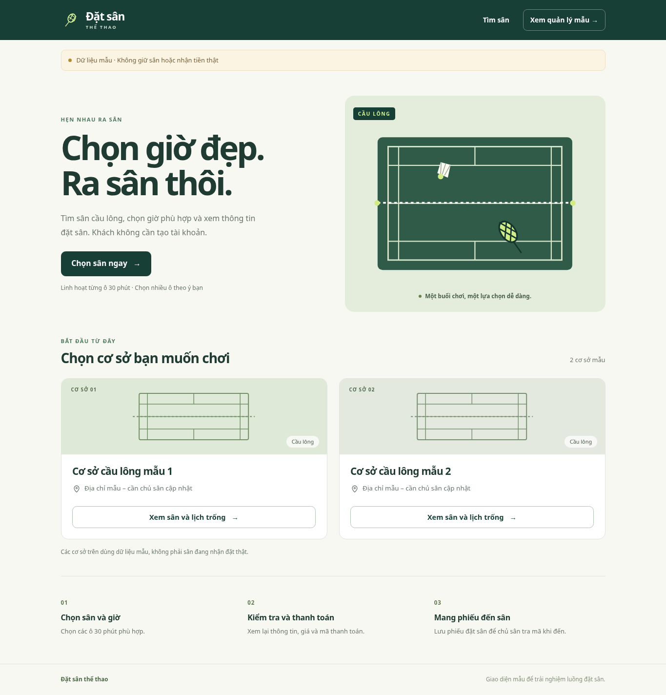

# Hệ thống quản lý đặt sân thể thao

Website đặt sân theo ô 30 phút. Khách không cần tài khoản: chọn sân, nhập tên/SĐT, thanh toán và nhận phiếu đặt sân. Chủ sân tra mã đơn trên hệ thống khi khách đến, kiểm tra đơn đã thanh toán và chưa check-in rồi ghi nhận khách đến sân.

Thời hạn hiện tại còn 3 tuần để hoàn thành và nộp final; ngày nộp cụ thể chưa được cung cấp. Repo đang là bộ khởi đầu có giao diện chạy thử, chưa phải hệ thống đặt sân hoàn chỉnh. Các thao tác mẫu không thay thế chức năng của bản final.

## Công nghệ

JavaScript, Node.js 24 LTS, Express 5, EJS, Bootstrap 5, MongoDB Atlas và Mongoose. Các thư viện session, bcrypt và Zod đã được chuẩn bị để phát triển tiếp.

## Chạy giao diện mẫu



Cài Node.js 24, sau đó mở terminal trong thư mục dự án:

```sh
npm ci
npm run dev
```

Mở `http://localhost:3000` trên máy đang chạy ứng dụng. Có thể dùng `npm start` để chạy không watch; nhấn Ctrl+C để dừng. Khi chưa có `.env`, ứng dụng mặc định dùng dữ liệu mẫu và không cần MongoDB.

Luồng chạy thử:

1. Chọn cơ sở mẫu, sân và ngày.
2. Chọn các ô 30 phút còn trống; có thể chọn các ô rời nhau.
3. Nhập tên/SĐT và kiểm tra thông tin, các ô đã chọn, tổng giá do backend tính.
4. Mở trang thanh toán mẫu để xem bố cục QR và đồng hồ 10 phút.
5. Bấm **Xem phiếu mẫu** để xem phiếu đặt sân; khách có thể chụp màn hình phiếu.
6. Mở `/demo/owner` để xem bố cục trang quản lý bằng dữ liệu mẫu.

**Chế độ mẫu không tạo booking hoặc giữ ô thật, không nhận/xác nhận tiền, không lưu dữ liệu vào MongoDB.** Phiên xem thử chỉ nằm trong bộ nhớ: có 10 phút để mở phiếu mẫu; dữ liệu được giữ tối đa một giờ và mất khi khởi động lại server. Nút xem phiếu mẫu không xác minh giao dịch ngân hàng. Trang quản lý mẫu không đăng nhập, không thao tác đơn/check-in thật; trang đăng nhập chủ sân vẫn chưa xác thực. Các đường dẫn `/demo/...` chỉ dùng trong `DEMO_MODE=true`.

## Luồng bản hoàn chỉnh

Chọn sân/ngày/ô → nhập tên/SĐT → backend giữ tất cả ô trong 10 phút → kiểm tra thông tin → trả toàn bộ tiền → backend xác minh nhận đủ tiền → phiếu đặt sân → chủ sân tra mã và check-in.

Phiếu cần mã đơn, tên/SĐT, sân, cơ sở/địa chỉ, ngày, từng ô giờ, số tiền và trạng thái. Ảnh chụp giúp tra cứu; chủ sân vẫn kiểm tra bản ghi hợp lệ trên hệ thống, không dùng ảnh làm bằng chứng đã nhận tiền. Khách nhắn Zalo được gửi link website để tự đặt; nhập đơn trực tiếp chỉ cần khi chủ sân vẫn nhận đặt/thu tiền ngoài web.

Chưa triển khai: đăng nhập/phân quyền chủ sân, ghi booking và transaction giữ chỗ, thanh toán tự động, quản lý sân/đơn, hủy/hoàn/đổi, check-in và báo cáo. MongoDB thật và kết nối MB Bank chưa được kiểm chứng. Các chi tiết còn mở nằm trong tài liệu quy tắc.

## Kiểm tra trước khi gửi Pull Request

```sh
npm run check
npm test
```

`check` kiểm tra JavaScript và biên dịch template EJS. Bộ test kiểm tra những luồng API, quy tắc và giao diện mẫu đã triển khai. Chưa có kiểm thử ghi dữ liệu MongoDB, đặt đồng thời hoặc giao dịch ngân hàng thật; check xanh không chứng minh các chức năng chưa làm đã đúng.

## Kết nối MongoDB khi phát triển tiếp

Sao chép `.env.example` thành `.env`. Dùng database riêng cho phát triển, điền `MONGODB_URI`, `SESSION_SECRET` ít nhất 32 ký tự và đặt `DEMO_MODE=false`. Giá trị cấu hình chỉ nằm ở máy của bạn hoặc phần Environment của máy chủ.

```sh
npm run seed
npm start
```

Seed chỉ thêm/cập nhật 2 cơ sở và 3 sân mẫu theo tên; không xóa toàn bộ database, không tạo tài khoản. Chế độ MongoDB hiện đọc cơ sở, sân và lịch; các API ghi đơn/xác thực sẽ được triển khai tiếp. Chế độ này không mở các trang xem thử `/demo/...`.

## Cấu trúc

```text
src/app.js             Trang EJS và API hiện có
src/server.js          Khởi động ứng dụng
src/config.js          Kiểm tra cấu hình
src/domain/            Quy tắc thời gian, giá, phí và dữ liệu khách
src/models/            Schema Mongoose
src/services/          Đọc dữ liệu và hỗ trợ luồng mẫu
src/data/              Dữ liệu giả cho UI
views/                 Giao diện EJS
public/                CSS và JavaScript trên trình duyệt
scripts/               Kiểm tra template và nhập dữ liệu mẫu
tests/                 Kiểm thử
docs/                  Tài liệu
.github/               CI và mẫu Pull Request
```

## Tài liệu hiện hành

- [Quy tắc nghiệp vụ hiện tại](docs/QUY_TAC_PROTOTYPE.md)
- [API đã có và dự kiến](docs/API.md)
- [Cách làm chung và bảo vệ main](CONTRIBUTING.md)
- [Các bước phát triển và chia task UI](docs/CONG_VIEC_TIEP_THEO.md)
- [Kế hoạch hoàn thành final trong 3 tuần](docs/KE_HOACH_3_TUAN.md)

Dùng tài liệu Markdown hiện hành làm căn cứ cho code. File Word, use case, ERD và state machine nộp final cần khớp nghiệp vụ hiện hành và chức năng đã hoàn thành; hiện chưa có bộ báo cáo/sơ đồ cập nhật trong repo.

## Giao task cho AI

Gửi link repo chưa đảm bảo AI đọc được code. Với công cụ có quyền đọc GitHub hoặc workspace, yêu cầu mở/clone repo. Nếu công cụ không có quyền truy cập, cung cấp các tài liệu và file liên quan; không gửi `.env` hay khóa dịch vụ.

Repo có [AGENTS.md](AGENTS.md) để AI tiếp nhận quy tắc. Mẫu prompt cho một task:

```text
Bạn hỗ trợ dự án này:
https://github.com/indominusrex932005-arch/Quan-ly-dat-san-the-thao

Trước khi sửa code, đọc AGENTS.md, README.md, CONTRIBUTING.md,
docs/QUY_TAC_PROTOTYPE.md, docs/API.md và code liên quan.
Phân biệt luồng mẫu đang chạy với chức năng thật chưa triển khai.

Task của tôi: [ghi một task cụ thể].
Phạm vi: [các trang hoặc module cần làm].
Tiêu chí đạt: [thao tác và kết quả kiểm tra mong muốn].

Giữ JavaScript/Express/EJS/Bootstrap/Mongoose và quy tắc hiện hành.
Làm trên nhánh feat/[ten-task]. Chạy npm run check và npm test nếu sửa code.
Báo file đã sửa, kết quả và phần còn thiếu.
Nếu không đọc được repo, nói rõ để tôi cung cấp file; không đoán code.
```

Nhóm trưởng giao phạm vi riêng, xem diff và kiểm tra thao tác trước khi merge. Việc AI đọc tài liệu không thay thế kiểm tra kết quả.

## Triển khai sau

Ứng dụng Express/EJS chạy chung một máy chủ. Trên Render, lệnh cài là `npm ci`, lệnh chạy là `npm start`; đặt `NODE_ENV=production`, `DEMO_MODE=false` và cấu hình database/session riêng. Chưa triển khai website công khai hoặc thiết lập Vercel Preview; chưa tích hợp MB Bank. Hoàn thiện và kiểm chứng chức năng trước khi dùng với khách và tiền thật.
